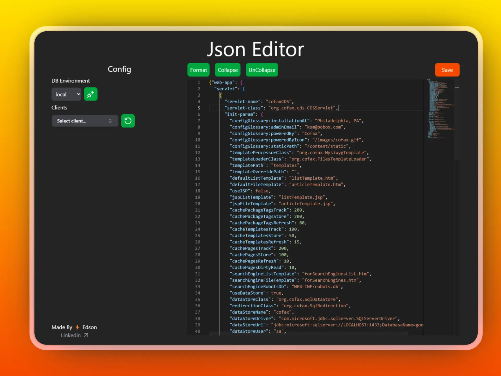

# Json-Editor



Monorepo con dos proyectos:

- `back`: API en NestJS.
- `front`: aplicación React + Vite.

En desarrollo cada uno corre en su propio puerto (el front usa Vite y proxyea
las llamadas a `/api` hacia el back). En producción el back compila y **sirve el
front ya compilado**, de modo que todo queda en **un solo puerto** y se puede
levantar con un único proceso de pm2.

Puertos:

| Entorno | Back (API)             | Front (Vite dev) |
| ------- | ---------------------- | ---------------- |
| Dev     | `4001`                 | `4002`           |
| Prod    | `4000` (sirve el front)| —                |

En producción el front **no** tiene puerto propio: lo sirve el back, así que
toda la app queda en el puerto `4000`.

## Instalación

Desde la raíz del repo, instala las dependencias de la raíz, del back y del
front en un solo comando:

```bash
npm run install:all
```

## Desarrollo (un solo comando)

```bash
npm run dev
```

Esto levanta ambos proyectos a la vez con hot reload:

- Back (NestJS) en `http://localhost:4001`, con el prefijo global `/api`
  (las rutas quedan como `/api/base/...` y `/api/clients/...`). El puerto se
  define con `PORT=4001` en `back/.env`.
- Front (Vite) en `http://localhost:4002`. El front llama a la API usando la
  ruta relativa `/api` (ver `front/.env`), y Vite la proxyea hacia
  `http://localhost:4001` gracias a `server.proxy` en `front/vite.config.ts`.

`Ctrl+C` detiene ambos procesos.

## Build de producción

```bash
npm run build
```

El build:

1. Compila el front (`front/dist`).
2. Compila el back (`back/dist`).
3. Copia `front/dist` dentro de `back/client` (de forma cross-platform con
   `shx`), para que el back sea autocontenido y pueda servir el front.

En runtime el back sirve los archivos estáticos desde `back/client` mediante
`ServeStaticModule`, y hace fallback a `index.html` para las rutas del SPA.
Las rutas que empiezan con `/api` quedan excluidas del servido estático y llegan
a los controladores de Nest.

## Arranque en producción (un solo puerto)

El proceso del back debe correr con su directorio de trabajo en `back/` para que
`@nestjs/config` cargue `back/.env`. Los scripts y la config de pm2 ya lo
resuelven.

Arranque directo:

```bash
npm start
```

Levanta solo el back compilado (que ya sirve el front) en el puerto 4000. Toda
la app queda disponible en `http://localhost:4000`.

Con pm2 (un solo proceso):

```bash
pm2 start ecosystem.config.cjs
```

`ecosystem.config.cjs` define un único proceso `json-editor` que ejecuta
`back/dist/main.js` con `cwd: ./back` y `PORT=4000` (este valor sobrescribe el
`PORT` de `back/.env`, que es para desarrollo).

Comandos útiles de pm2:

```bash
pm2 reload json-editor    # recarga sin downtime
pm2 restart json-editor
pm2 logs json-editor
pm2 delete json-editor
```

## Poner en producción tras un cambio

```bash
git pull
npm run install:all      # solo si cambiaron dependencias
npm run build
pm2 reload json-editor
```

## Variables de entorno

- Back: copia `back/.env.example` a `back/.env` y completa las credenciales.
  El proceso debe correr con cwd `back/` (ya lo hacen los scripts `start` y la
  config de pm2) para que ese `.env` se cargue.
- Front: `front/.env` usa `VITE_API_URL=/api` (ruta relativa) para que la misma
  configuración funcione tanto en desarrollo (vía el proxy de Vite) como en
  producción (mismo origen que el back).

## Schemas de configuración Base

Los JSON Schema ubicados en `front/src/schemas` se descubren automáticamente
durante el build. Cada archivo se aplica a un atributo raíz de la configuración
Base, sin afectar el editor de datos de Clients.

El atributo se obtiene primero de la extensión incluida en el schema:

```json
{
  "x-config-attribute": "automated"
}
```

Si la extensión no existe, se deriva del nombre del archivo. Por ejemplo,
`automated-config.schema.json` se aplica al atributo `automated`. Si dos schemas
apuntan al mismo atributo o no se puede resolver un nombre válido, la aplicación
falla durante su inicialización para evitar una configuración ambigua.

Para agregar un nuevo contrato solamente se debe copiar su archivo
`*.schema.json` dentro de `front/src/schemas` y reconstruir el frontend.
